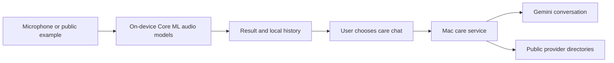

# Heart Echo

### Heart-sound analysis on your phone, with a path to finding care

**Veritas AI Hackathon 2026 · AI + Health · Experimental prototype**

**This project is a prototype and is not medical advice.**

Heart Echo explores a simple question: can a phone make heart-sound screening easier to access, while being honest when it cannot give a clear answer? It combines on-device audio models, a result-first iPhone interface, and a conversational assistant for exploring public care listings.

**Start here:** [Judge walkthrough](docs/JUDGE_GUIDE.md) · [Results](docs/RESULTS.md) · [Credits](CREDITS.md) · [Submission checklist](docs/SUBMISSION.md)

## Who it helps

The intended user wants to record heart sounds, understand an experimental finding, and prepare for a conversation with a clinician. The aim is to make that next step easier. Reliable screening from a bare phone microphone remains a research goal.

## What works

1. Analyze a guided 20-second recording or a bundled public example.
2. Run a trained murmur-pattern model on the iPhone. Results distinguish **murmur-like pattern**, **not detected in this recording**, and **unsure**. BPM is estimated separately when the signal supports it.
3. Review the result before choosing **Find care with AI**. Saved results retain the actual finding and model revision.
4. Use one shared chat for general questions and care navigation. Provider cards come from public directories, with source links and coverage limitations.

## How AI is used

The audio models were trained on public heart-sound data. The murmur model uses heart-cycle timing supervision; BPM has an independent model and decision path. Gemini generates chat replies and is not the audio detector. Recorded audio and result summaries are not sent to Gemini. [Architecture and source map](docs/JUDGE_GUIDE.md#where-to-look-in-the-code)

## What we measured

The shipping murmur model detected **49 of 70 positive public development recordings**; 8 were called absent and 13 returned unsure. It raised 5 false alarms among 274 absent recordings. These are reused development results, **not independent phone accuracy**. [Baseline comparisons and evidence](docs/RESULTS.md)

Software checks cover invalid audio, recording persistence, pairing, conversations, and directory validation. The care flow was also checked on a physical iPhone using sample details. These checks establish behavior, not medical effectiveness.

## Review or run it

- **Without Xcode or a key:** inspect the evidence or run the browser's labeled guided directory mode.
- **On a Mac:** build the iPhone app and analyze bundled public examples; audio inference needs no cloud AI.
- **With your own Gemini key:** pair the phone with the Mac service and try a conversation using sample details.

Prerequisites, commands and expected outputs are in the [judge walkthrough](docs/JUDGE_GUIDE.md).

## Limits and next steps

Phone-microphone accuracy is unvalidated. An absent result does not rule out disease. Listings do not confirm insurance or appointments. The demo is not HIPAA compliant; local HTTP and free-tier chat are unsuitable for patient-data deployment. The next steps are an independent clinician-labeled phone cohort and stronger privacy/security controls.

The app lives in [`HeartEcho/`](HeartEcho/README.md). [`ChestBPM/`](ChestBPM/README.md) preserves the original in-event prototype; [`research/`](research/) contains experimental alternatives and historical reports. [Credits and contribution disclosure](CREDITS.md) identify reuse, AI assistance and source licenses.
